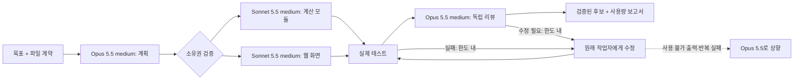

# Opus Orchestrator

이 문서는 **`claude -p` CLI 방식**의 한국어 안내입니다. Claude Code 네이티브 스킬·플러그인의 설치와 사용법은 [영문 README](README.md)와 [네이티브 모드 안내](docs/native-mode.md)를 참고하세요.

**Claude Opus 5.5가 계획과 리뷰를 맡고, Claude Sonnet 5.5가 범위가 정해진 코드를 작성합니다.** 실행 결과는 별도의 후보 폴더에 보관하고, 테스트와 리뷰를 통과한 파일만 적용할 수 있습니다.

> 0.2.0까지는 Codex에서 GPT-6 Astra(`gpt-6-astra`)와 GPT-5.6 Luna(`gpt-5.6-luna`)를 썼습니다. 0.3.0부터 Claude Code에서 Opus 5.5(`claude-opus-5-5`)와 Sonnet 5.5(`claude-sonnet-5-5`)를 씁니다. 역할 분담, 파일 계약, 검사·리뷰 관문은 그대로이며, 역할 배정 근거와 바뀐 점은 [전환 문서](docs/migration-claude.md)에 있습니다.

Node.js로 직접 만든 작은 CLI입니다. Claude Code의 기존 로그인(구독 로그인 또는 `ANTHROPIC_API_KEY`)과 `claude -p`를 사용하며 npm 런타임 의존성은 없습니다. 모델 조합 자체가 할인이나 캐시 적중을 보장하지는 않습니다.



## 시작하기

Node.js 22 이상과 Claude Code 2.1.284 이상이 필요합니다. `claude --help`에 `--json-schema`, `--effort`, `--tools`, `--setting-sources`, `--no-session-persistence`가 있어야 합니다. 2026-11-02에 Linux, Claude Code 2.1.316으로 실제 호출을 확인했습니다.

```sh
git clone https://github.com/shinjh0380/opus5.5-orchestrator.git
cd opus5.5-orchestrator
npm test
node bin/astra.mjs run examples/cache-lab/job.json --dry-run --out .runs/check
node bin/astra.mjs run examples/cache-lab/job.json --out .runs/demo
```

`--dry-run`은 입력과 파일 범위를 검증하고 후보 폴더를 준비하며, 모델을 호출하지 않습니다. 실제 `run`은 모델 사용량을 소비합니다. 같은 출력 폴더는 다시 쓸 수 없으므로 실행할 때마다 새 경로를 지정하세요.

PATH의 CLI 대신 다른 설치를 쓰려면 `--claude /absolute/path/to/claude` 또는 `CLAUDE_BIN`을 지정합니다. 이전의 `--codex`/`CODEX_BIN`은 더 이상 쓰이지 않습니다. 각 하위 호출은 도구 없음, 사용자·프로젝트·로컬 설정 무시, MCP·스킬 비활성, 세션 저장 안 함 상태로 실행됩니다. 모델과 effort는 `job.json`에서 고정합니다. CLI가 요청과 다른 모델의 사용량을 보고하면 그 호출은 실패로 처리합니다.

실행 후 `.runs/demo/report.html`에서 모델별 사용량과 검사 결과를 확인합니다. 생성된 웹 도구는 `.runs/demo/candidate/`에 있습니다.

```sh
python3 -m http.server 8791 --bind 127.0.0.1 --directory .runs/demo/candidate
```

검토가 끝난 후보는 원래 seed 또는 같은 내용의 작업 사본에 적용할 수 있습니다.

```sh
node bin/astra.mjs apply .runs/demo examples/cache-lab/seed
```

적용 전에 원본 컨텍스트와 후보의 해시를 모두 확인하고, 원본이 바뀌었으면 중단합니다. 여러 파일을 원자적으로 교체하는 트랜잭션은 아니므로 버전 관리 중인 작업 사본에서 사용하세요.

## 역할과 모델

| 역할 | 이전 | 현재 | 근거 요약 |
|---|---|---|---|
| planner(계획, solo 구현) | GPT-6 Astra low | Opus 5.5 **medium** | 같은 평가 환경에서 Opus low가 Astra low보다 낮고, medium은 더 높음(AA 지수 35/48 vs 43) |
| worker(구현) | GPT-5.6 Luna medium | Sonnet 5.5 medium | 범위가 정해진 구현에서 Opus와 대등하거나 앞서고 더 빠르며 가격은 절반 |
| reviewer(독립 리뷰) | GPT-6 Astra low | Opus 5.5 **medium** | 리뷰 정밀도와 긴 문맥 처리에서 Opus 우세. effort는 planner와 같은 이유 |
| escalation(선택) | 없음 | Opus 5.5 medium | 관찰 가능한 조건에서만 사용 |

벤치마크 출처, 비교 조건, 확인되지 않은 부분은 [전환 문서](docs/migration-claude.md)에 정리했습니다.

## 자신의 프로젝트에 쓰기

`examples/cache-lab/job.json`을 복사해서 `source`, `goal`, `context`, `outputs`, `checks`를 바꾸세요. `source`는 job 파일 기준 상대 경로이고, context와 outputs는 source 기준의 명시적 상대 파일 경로입니다. 와일드카드, 숨김 파일, 심볼릭 링크는 받지 않습니다. `checks`는 셸 문자열이 아니라 명령 인자 배열입니다.

- `maxWorkers`: 동시에 실행할 수 있는 독립 작업 수의 상한(최대 4).
- `maxCalls`: 계획·구현·수정·리뷰·상향 호출을 모두 포함한 호출 수 상한.
- `maxRepairs`: 테스트 또는 리뷰 실패 이후의 수정 라운드 상한.
- `maxPromptChars`: 요청마다 전달하는 **글자 수** 상한(토큰 상한이 아님).
- `stopAfterTokens`: CLI 자체 보조 모델 호출을 포함해 관측된 토큰 합이 이 값을 넘으면 다음 호출을 막는 기준. 진행 중이거나 병렬인 호출 때문에 초과할 수 있으며, 결제 상한이 아닙니다.
- `timeoutSeconds`: 각 CLI 호출과 검사의 제한 시간.
- `models.*`: `claude-`로 시작하는 고정 모델 ID와 effort(`low`~`max`). `opus` 같은 별칭과 `gpt-*`는 거부합니다.
- `models.escalation`(선택, team 모드): 작업자 출력을 쓸 수 없을 때(스키마 위반, 잘림, 소유하지 않은 파일) 해당 작업을 한 번만 상향합니다. 또 작업자가 이미 한 번 수정했는데도 검증이 실패하면 다음 수정을 상향 모델로 진행합니다. 인증·네트워크 오류는 상향하지 않습니다. 상향 호출도 호출·토큰 한도에 포함되며 `receipt.escalations`에 기록됩니다.
- `promptCaching`: 기본값 `off`(`DISABLE_PROMPT_CACHING=1`)입니다. `cli-default`로 바꾸면 Claude Code 기본 캐시를 쓰며, 이때 1시간 캐시 쓰기 비용은 입력 단가의 2배입니다.

## 사용량을 읽는 법

`receipt.json`과 HTML은 **실측 토큰을 Claude API Standard 정가로 환산**합니다. 구독 청구서나 한도 사용률을 뜻하지 않습니다. 원문: [가격](https://platform.claude.com/docs/en/about-claude/pricing).

입력은 일반 입력, 캐시 읽기, 캐시 쓰기(5분/1시간 구분)의 합으로 정규화합니다. thinking 토큰은 output에 이미 포함되어 있으므로 다시 더하지 않습니다. Claude Code가 내부적으로 다른 모델(예: Haiku 5.5)을 짧게 호출하면 `auxiliary`로 따로 기록하고, 역할별 비용 추정에는 넣지 않습니다. 모델 이름은 고정한 CLI 인자와 CLI가 보고한 모델별 사용량 키이며, 서버 내부 모델을 독립적으로 증명하지는 않습니다.

## 데이터와 실행 범위

선택한 context와 목표는 Claude Code를 통해 Anthropic에 전송됩니다. 하위 호출에는 도구를 주지 않지만, 이것이 보안 격리는 아닙니다. 선언한 `checks`는 생성된 코드를 **호스트에서 실행**합니다. 신뢰하는 작업과 폐기해도 되는 작업 사본에서 쓰세요. `.runs/`에는 프롬프트, 응답, 진단 로그가 있으며 gitignore에 포함되어 있습니다.

## 결과와 기록

- [Claude 실측 결과](docs/claude-live-results.md)와 [공개 영수증](examples/published-claude/)
- [전환 문서: 역할 매핑, 벤치마크 출처, 남은 위험](docs/migration-claude.md)
- [이전 Astra/Luna 실측 결과(보존 기록)](docs/live-results.md)와 [실험 조건](docs/experiment-protocol.md)

작은 표본의 관측값을 보편적인 품질 또는 절약 지표로 해석하지 마세요.

## 감사의 말

[dante01yoon](https://github.com/dante01yoon)의 [astra-orchestrator](https://github.com/dante01yoon/astra-orchestrator)를 보고 포크해서 만들었습니다. 계획·구현·리뷰 구조, 파일 계약, 검증 관문, 설치 스크립트와 기존 Astra/Luna 실측 기록은 원작자의 작업이며, 이 포크는 이를 Claude Opus 5.5와 Sonnet 5.5로 옮겼습니다. Thanks for dante01yoon!

## 참고와 라이선스

[donvito/codex-astra-luna-orchestrator](https://github.com/donvito/codex-astra-luna-orchestrator)(Apache-2.0)의 역할 분리 아이디어를 참고했습니다. 비교한 커밋은 `f1de1b8729c8ccfb7978321b4764c58bd34c8493`입니다. [DannyMac180/sol-advisor](https://github.com/DannyMac180/sol-advisor)도 참고했습니다. 이 저장소의 실행기와 검증 코드는 독립적으로 작성했으며, 어느 프로젝트도 이 저장소를 보증하거나 이와 제휴하지 않습니다.

MIT License. 비용 절감률이나 결과 품질을 보장하지 않습니다.
