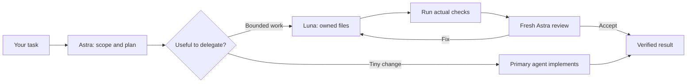

# Astra Orchestrator

**Astra plans and reviews. Luna implements focused tasks. Use it inside Codex, or run the existing CLI for a recorded experiment.**

[Native setup](docs/native-mode.md) · [CLI results](docs/live-results.md) · [Validation](docs/native-validation.md) · [한국어 CLI 안내](README.ko.md)

Two ways to use the same approach:

| | Native skill / plugin | Standalone CLI |
|---|---|---|
| Start with | A normal coding request in Codex | An explicit `job.json` |
| Workers | Native subagents in your conversation | Separate `codex exec` calls |
| Best for | Everyday work in an existing repository | Bounded file-generation tasks and repeatable comparisons |
| File scope | Ownership instructions and diff review under host permissions | Runtime validation of returned file paths; staged candidate files |
| Validation | Primary agent runs checks, then requests an independent review | Automated checks and review gates before candidate acceptance |
| Usage record | Only usage the host actually exposes; otherwise unavailable | JSONL token receipts and Standard API cost equivalents |

Neither mode guarantees savings, cache hits, or a particular result. A small task may be better handled by one agent.



## Quick start: use it inside Codex

Requires Node.js 22+ for installation, access to Astra and Luna, and a current Codex host with native subagents. Native work uses your Codex account's model access and usage; no extra API key is required by this project.

```sh
git clone https://github.com/dante01yoon/astra-orchestrator.git
cd astra-orchestrator
node plugins/astra-orchestrator/scripts/install-native.mjs --project /absolute/path/to/your-project
```

Open a new trusted Codex task in **your project**, select **GPT-6 Astra** as the primary model, and say:

```text
$astra-orchestrator Add CSV export to the existing reports page.
Preserve existing behavior and run the relevant checks before review.
```

The installer adds the skill to `.agents/skills/` and two role profiles to `.codex/agents/`. It preserves existing `config.toml`, permissions, authentication, MCP settings, and `AGENTS.md`. A user-modified or conflicting role file is not overwritten. Use `--dry-run` to preview or `--check` to verify an installation.

The primary agent scopes the work, gives Luna an explicit file contract, verifies the result, and asks a fresh Astra reviewer to inspect it. One implementer is the default for bounded work; two are used only for independent files. Tiny changes stay with the primary agent unless you explicitly request delegation.

**The skill cannot switch your primary model.** The default worker is Luna medium; the reviewer is Astra low. Role files pin these values where supported. On hosts exposing explicit model selection in native spawn tools, the skill can request those values directly. If neither route is available, it reports the missing capability instead of silently changing models or starting the CLI.

### Prefer a plugin?

Install the same skill from this repository's marketplace:

```sh
codex plugin marketplace add dante01yoon/astra-orchestrator
codex plugin add astra-orchestrator@astra-orchestrator
```

Start a new Codex session and select the skill from the picker, or invoke `$astra-orchestrator:astra-orchestrator` (the plugin-qualified name). The standalone installation uses `$astra-orchestrator`. Plugin support is available in the Codex app and CLI; use the standalone skill in the IDE extension.

**Plugin installation alone does not register the companion custom-agent TOMLs.** If your host cannot select models directly in its native spawn tool, clone this repository and install just the roles:

```sh
node plugins/astra-orchestrator/scripts/install-native.mjs --project /absolute/path/to/your-project --roles-only
```

Choose either the standalone skill or the plugin to avoid duplicate skill entries. See [native setup, model routing, and removal](docs/native-mode.md).

## Existing CLI: explicit jobs and recorded runs

The `codex exec` runner remains available. It is independent of the plugin and never activates as an automatic fallback.

Use Node.js 22+ and a current Codex CLI whose `exec --help` includes `--ignore-user-config`, `--ephemeral`, `--output-schema`, and `--json`. Live calls were verified on macOS with Codex CLI 0.153.4. This repository has no npm runtime dependencies.

```sh
npm test
node bin/astra.mjs run examples/cache-lab/job.json --dry-run --out .runs/check
node bin/astra.mjs run examples/cache-lab/job.json --out .runs/demo
```

`--dry-run` validates the job and prepares a candidate without model calls. A live run consumes model usage. Each run needs a new output directory. To select another CLI installation, pass `--codex /absolute/path/to/codex` or set `CODEX_BIN`. The runner uses existing Codex authentication, ignores user configuration for the child requests, and pins models and effort from the job without changing global settings.

Open `.runs/demo/report.html` for checks and usage. The generated files are in `.runs/demo/candidate/`:

```sh
python3 -m http.server 8791 --bind 127.0.0.1 --directory .runs/demo/candidate
```

After review, apply the accepted candidate to the original seed or an identical working copy:

```sh
node bin/astra.mjs apply .runs/demo examples/cache-lab/seed
```

Application verifies original context and candidate hashes and stops if they changed. It is not a transaction across all files; use a version-controlled working copy.

### Adapt a CLI job

Copy `examples/cache-lab/job.json` and change `source`, `goal`, `context`, `outputs`, and `checks`. `source` is relative to the job file; context and output paths are explicit files relative to source. Wildcards, hidden paths, and symlinks are rejected. Checks are argument arrays, not shell strings.

Define interfaces, owned files, error handling, and acceptance checks before delegation. Keep dependent files together or settle their contract first. `mode: "solo"` skips the planner and uses Astra implementation plus the same independent review.

| Setting | Meaning |
|---|---|
| `maxWorkers` | Concurrent independent workers; at most 4 |
| `maxCalls` | Total planning, implementation, repair, and review calls |
| `maxRepairs` | Repair rounds after failed tests or review |
| `maxPromptChars` | Characters per request, not tokens |
| `stopAfterTokens` | Stops admission of new calls after observed usage crosses the threshold; in-flight calls can exceed it |
| `timeoutSeconds` | Timeout for each CLI call and check |

The runner receives complete files as structured JSON. It validates missing, duplicate, and cross-worker output paths before accepting them. It is designed for bounded file generation, not unrestricted repository exploration or long-running task graphs. Regenerating large files can be expensive. Neither mode commits or deploys automatically.

## What we actually measured

One CLI pilot on September 7, 2026, compared the same Cache Lab contract and 11 checks:

| | Astra + Luna | Astra solo + review |
|---|---:|---:|
| Total input + output tokens | 84,729 | 48,180 |
| Cached input tokens | 0 | 0 |
| Standard API equivalent | $0.5204534 | $0.6716800 |
| Checks | 11/11 | 11/11 |

In this pair, the team used **75.9% more tokens** but had a **22.5% lower API-equivalent cost** because work was routed to a cheaper model. This is one uncontrolled comparison, **not a native-mode benchmark or evidence of cache savings**. Two earlier development failures cost another $0.45233 equivalent and are published separately. See [results and limitations](docs/live-results.md), [protocol](docs/experiment-protocol.md), and [original receipts](examples/published/).

CLI reports use recorded input, cached-read, cached-write, and output fields with a dated Standard API price table. Reasoning output is already part of output. Missing fields or insufficient per-request context information limit the estimate. These are not ChatGPT subscription bills, quota percentages, or total project costs. Check [official pricing](https://developers.openai.com/api/docs/pricing) and [prompt caching](https://developers.openai.com/api/docs/guides/prompt-caching) before comparing costs.

Every CLI role starts a fresh request. Different prompts, tools, schemas, or prefixes can prevent cache reuse. This project does not implement API `configuration_update` or repair Codex cache behavior. Native usage is reported only when exposed by the host; the CLI pilot's figures are never substituted for it.

## Execution and data

Native agents use host tools and permissions. Their file ownership is an instruction plus diff inspection, not a filesystem boundary. A requested read-only reviewer profile can be broadened by live host overrides.

The CLI sends the goal and selected context to Codex. It requests no tool use and a read-only sandbox for model calls, but that is not isolation from all file reads. Declared checks execute generated code on the host. Use trusted tasks and disposable, version-controlled workspaces. `.runs/` contains prompts, responses, and diagnostic logs and is gitignored. There is no automatic upload or analytics; select artifacts deliberately before sharing them.

## Development and references

- [Contributing](CONTRIBUTING.md)
- [Native skill](plugins/astra-orchestrator/skills/astra-orchestrator/SKILL.md) and [installer](plugins/astra-orchestrator/scripts/install-native.mjs)
- [CLI validation and pricing](src/core.mjs) and [runner](src/runner.mjs)
- [Native validation evidence](docs/native-validation.md)

Inspired by the role separation in [donvito/codex-astra-luna-orchestrator](https://github.com/donvito/codex-astra-luna-orchestrator), which provides native Codex configuration, skills, and usage tools under Apache-2.0. The original comparison used commit `f1de1b8729c8ccfb7978321b4764c58bd34c8493`. [DannyMac180/sol-advisor](https://github.com/DannyMac180/sol-advisor) provides another selective-delegation approach with a Sol primary and Luna/Terra workers. Its plugin-plus-companion-role pattern informed the installation UX. This implementation was written independently; neither project endorses it.

MIT License.
