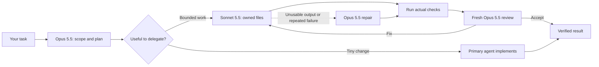

# Opus Orchestrator

**Claude Opus 5.5 plans and reviews. Claude Sonnet 5.5 implements focused tasks. Use it inside Claude Code, or run the CLI for a recorded experiment.**

[Native setup](docs/native-mode.md) · [Claude results](docs/claude-live-results.md) · [Migration from Astra/Luna](docs/migration-claude.md) · [Validation](docs/native-validation.md) · [한국어 CLI 안내](README.ko.md)

> This repository is a fork of [dante01yoon/astra-orchestrator](https://github.com/dante01yoon/astra-orchestrator), ported to Claude. Versions up to 0.2.0 ran on Codex with GPT-6 Astra and GPT-5.6 Luna. 0.3.0 runs on Claude Code with Opus 5.5 and Sonnet 5.5. The role split, file contracts, checks and review gates are unchanged; [migration notes](docs/migration-claude.md) explain the role mapping, its evidence and what changed. The Astra/Luna pilot results below are kept as historical records.

Two ways to use the same approach:

| | Native skill / plugin | Standalone CLI |
|---|---|---|
| Start with | A normal coding request in Claude Code | An explicit `job.json` |
| Workers | Native subagents in your conversation | Separate `claude -p` calls |
| Best for | Everyday work in an existing repository | Bounded file-generation tasks and repeatable comparisons |
| File scope | Ownership instructions and diff review under host permissions | Runtime validation of returned file paths; staged candidate files |
| Validation | Primary agent runs checks, then requests an independent review | Automated checks and review gates before candidate acceptance |
| Usage record | Only usage the host actually exposes; otherwise unavailable | Per-call token receipts and Claude API list-price equivalents |

Neither mode guarantees savings, cache hits, or a particular result. A small task may be better handled by one agent.



## Quick start: use it inside Claude Code

Requires Claude Code 2.1.284+ (for Sonnet 5.5) with access to Opus 5.5 and Sonnet 5.5. Native work uses your Claude Code account's model access and usage; no extra API key is required by this project.

```sh
claude plugin marketplace add shinjh0380/opus5.5-orchestrator
claude plugin install astra-orchestrator@astra-orchestrator
```

Or, inside a session:

```text
/plugin install astra-orchestrator --marketplace shinjh0380/opus5.5-orchestrator
```

The plugin ships the skill and both pinned subagents. Open Claude Code in **your project**, select **Opus 5.5** (`/model claude-opus-5-5`) as the primary model, and say:

```text
/astra-orchestrator:astra-orchestrator Add CSV export to the existing reports page.
Preserve existing behavior and run the relevant checks before review.
```

Prefer a project installation instead of the plugin? Use Node.js 22+:

```sh
git clone https://github.com/shinjh0380/opus5.5-orchestrator.git
cd opus5.5-orchestrator
node plugins/astra-orchestrator/scripts/install-native.mjs --project /absolute/path/to/your-project
```

The installer adds the skill to `.claude/skills/` and two subagents to `.claude/agents/`, then invoke `/astra-orchestrator`. It preserves existing `settings.json`, permissions, authentication, MCP settings, and `CLAUDE.md`. A user-modified or conflicting file is not overwritten. Use `--dry-run` to preview or `--check` to verify an installation. Choose the plugin or the project skill, not both.

The primary agent scopes the work, gives the Sonnet worker an explicit file contract, verifies the result, and asks a fresh Opus reviewer to inspect it. One implementer is the default for bounded work; two are used only for independent files. Tiny changes stay with the primary agent unless you explicitly request delegation. A task moves to Opus only on observable conditions: an unusable result, the same failure after one Sonnet repair, or difficulty declared before delegation.

**The skill cannot switch your primary model.** The worker is `claude-sonnet-5-5` at medium effort; the reviewer is `claude-opus-5-5` at medium effort. Subagent files pin these values. If they are missing, the skill reports that the `Agent` tool can only request unpinned aliases instead of silently changing models or starting the CLI.

## CLI: explicit jobs and recorded runs

The `claude -p` runner is independent of the plugin and never activates as an automatic fallback.

Use Node.js 22+ and Claude Code 2.1.284+ whose `claude --help` lists `--json-schema`, `--effort`, `--tools`, `--setting-sources` and `--no-session-persistence`. Live calls were verified on Linux with Claude Code 2.1.316 on November 2, 2026. This repository has no npm runtime dependencies.

```sh
npm test
node bin/astra.mjs run examples/cache-lab/job.json --dry-run --out .runs/check
node bin/astra.mjs run examples/cache-lab/job.json --out .runs/demo
```

`--dry-run` validates the job and prepares a candidate without model calls. A live run consumes model usage. Each run needs a new output directory. To select another CLI installation, pass `--claude /absolute/path/to/claude` or set `CLAUDE_BIN`. The runner uses existing Claude Code authentication (subscription login or `ANTHROPIC_API_KEY`), and runs each child request with no tools, no user/project/local settings, no MCP servers, no skills and no saved session. It pins the model and effort from the job without changing global settings, and fails a call when the CLI reports a model other than the requested one.

Open `.runs/demo/report.html` for checks and usage. The generated files are in `.runs/demo/candidate/`:

```sh
python3 -m http.server 8791 --bind 127.0.0.1 --directory .runs/demo/candidate
```

After review, apply the accepted candidate to the original seed or an identical working copy:

```sh
node bin/astra.mjs apply .runs/demo examples/cache-lab/seed
```

Application verifies original context and candidate hashes and stops if they changed. It is not a transaction across all files; use a version-controlled working copy.

### Adapt a CLI job

Copy `examples/cache-lab/job.json` and change `source`, `goal`, `context`, `outputs`, and `checks`. `source` is relative to the job file; context and output paths are explicit files relative to source. Wildcards, hidden paths, and symlinks are rejected. Checks are argument arrays, not shell strings.

Define interfaces, owned files, error handling, and acceptance checks before delegation. Keep dependent files together or settle their contract first. `mode: "solo"` skips the planner and uses Opus implementation (the planner lane) plus the same independent review.

| Setting | Meaning |
|---|---|
| `maxWorkers` | Concurrent independent workers; at most 4 |
| `maxCalls` | Total planning, implementation, repair, and review calls |
| `maxRepairs` | Repair rounds after failed tests or review |
| `maxPromptChars` | Characters per request, not tokens |
| `stopAfterTokens` | Stops admission of new calls after observed usage (including the CLI's auxiliary model calls) crosses the threshold; in-flight calls can exceed it |
| `timeoutSeconds` | Timeout for each CLI call and check |
| `models.planner` / `worker` / `reviewer` | Pinned `claude-*` model ID and effort (`low`, `medium`, `high`, `xhigh`, `max`). Aliases and legacy `gpt-*` IDs are rejected |
| `promptCaching` | `off` (default) sets `DISABLE_PROMPT_CACHING=1` for child calls; `cli-default` keeps Claude Code's caching, which writes each prompt to the 1-hour cache at 2× input price |
| `models.escalation` | Optional. Team mode only: a worker task moves to this lane once when its output is unusable (no schema-valid answer, truncated, wrong files), or when validation still fails after a repair by the worker lane. Escalated calls count toward `maxCalls` and `stopAfterTokens` and are listed in `receipt.escalations` |

The runner receives complete files as structured JSON. It validates missing, duplicate, and cross-worker output paths before accepting them. It is designed for bounded file generation, not unrestricted repository exploration or long-running task graphs. Regenerating large files can be expensive. Neither mode commits or deploys automatically.

## What we actually measured

On November 2, 2026, the same Cache Lab contract, 11 checks and budgets ran with the new models ([details](docs/claude-live-results.md)):

| | Opus + Sonnet team | Opus solo + review | Historical Astra + Luna team | Historical Astra solo |
|---|---:|---:|---:|---:|
| Calls | 7 (one review-driven repair) | 2 | 4 | 2 |
| Input + output tokens | 171,825 | 62,752 | 84,729 | 48,180 |
| API list-price equivalent | $0.7088 | $0.4995 | $0.5205 | $0.6717 |
| Wall time | 158.9 s | 143.6 s | 140.8 s | 156.8 s |
| Checks / browser probe | 11/11 · 8/8 | 11/11 · 8/8 | 11/11 · 8/8 | 11/11 · 8/8 |

All runs were accepted and passed the same behavioural checks. The Opus reviewer rejected the first Sonnet candidate in both team runs because blank fields were silently read as 0, and one repair fixed it. Opus costs only 2× Sonnet (Astra cost 50× Luna), so **the team route was 41.9% more expensive than solo** in this sample, where it used to be 22.5% cheaper. These are single uncontrolled samples, not a benchmark. Prompt caching is off by default because Claude Code's 1-hour cache writes raised one-shot costs by 14–27% here.

The September 7, 2026 Astra/Luna pilot, its protocol and its two failed development runs ($0.45233) remain published as [historical results](docs/live-results.md) with [original receipts](examples/published/).

CLI reports use the recorded input, cache-read, cache-write (5-minute / 1-hour) and output fields with a dated Claude API list-price table. Thinking tokens are already part of output. Small calls that Claude Code makes to other models on its own (Haiku 5.5 was observed) are recorded separately as `auxiliary`. These figures are not subscription bills, quota percentages, or total project costs. Check [official pricing](https://platform.claude.com/docs/en/about-claude/pricing) before comparing costs. Native usage is reported only when exposed by the host; CLI figures are never substituted for it.

## Execution and data

Native agents use host tools and permissions. Their file ownership is an instruction plus diff inspection, not a filesystem boundary. The reviewer subagent has no Edit/Write tool, but its Bash tool can write, and plugin subagents ignore `permissionMode`.

The CLI sends the goal and selected context to Anthropic through Claude Code. Child calls get no tools at all, but that is not isolation from all file reads by the host. Declared checks execute generated code on the host. Use trusted tasks and disposable, version-controlled workspaces. `.runs/` contains prompts, responses, and diagnostic logs and is gitignored. There is no automatic upload or analytics; select artifacts deliberately before sharing them.

## Development and references

- [Contributing](CONTRIBUTING.md)
- [Native skill](plugins/astra-orchestrator/skills/astra-orchestrator/SKILL.md) and [installer](plugins/astra-orchestrator/scripts/install-native.mjs)
- [CLI validation and pricing](src/core.mjs) and [runner](src/runner.mjs)
- [Native validation evidence](docs/native-validation.md)
- [Migration from Astra/Luna: role mapping, benchmark sources, risks](docs/migration-claude.md)
- [Historical recorded feature demo (Codex): CSV export](examples/native-cache-lab/)

The title is now Opus Orchestrator. The CLI command, plugin and skill identifiers (`astra-orchestrator`) are unchanged from the Codex version so existing job files and install commands keep working. Inspired by the role separation in [donvito/codex-astra-luna-orchestrator](https://github.com/donvito/codex-astra-luna-orchestrator), which provides native Codex configuration, skills, and usage tools under Apache-2.0. The original comparison used commit `f1de1b8729c8ccfb7978321b4764c58bd34c8493`. [DannyMac180/sol-advisor](https://github.com/DannyMac180/sol-advisor) provides another selective-delegation approach with a Sol primary and Luna/Terra workers. Its plugin-plus-companion-role pattern informed the installation UX. This implementation was written independently; neither project endorses it.

## Thanks

Thanks to [dante01yoon](https://github.com/dante01yoon) for [astra-orchestrator](https://github.com/dante01yoon/astra-orchestrator). This project started as a fork of it: the planner/worker/reviewer design, file contracts, validation gates, installer and the original Astra/Luna evidence are their work. This fork ports it to Claude Opus 5.5 and Sonnet 5.5.

MIT License. The original copyright notice is kept in [LICENSE](LICENSE).
