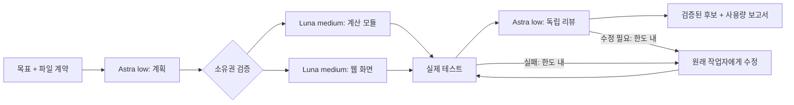

# Astra Orchestrator

**Astra가 계획과 리뷰를 맡고, Luna가 범위가 정해진 코드를 작성합니다.** 실행 결과는 별도의 후보 폴더에 보관하고, 테스트와 리뷰를 통과한 파일만 적용할 수 있습니다.

Node.js로 직접 만든 작은 CLI입니다. Codex의 기존 로그인과 `codex exec`를 사용하며, 추가 API 키나 npm 런타임 의존성이 필요하지 않습니다. 구독 모델 접근 권한과 사용량은 필요합니다. 모델 조합 자체가 할인이나 캐시 적중을 보장하지는 않습니다.



## 시작하기

Node.js 22 이상, `codex exec --help`에 `--ignore-user-config`, `--ephemeral`, `--output-schema`, `--json`이 있는 최신 Codex CLI가 필요합니다. macOS에서 Codex CLI 0.153.4로 실제 연결을 확인했습니다. 다른 플랫폼은 CI의 코드 검사와 실제 모델 실행 검증 범위가 다릅니다.

```sh
git clone https://github.com/dante01yoon/astra-orchestrator.git
cd astra-orchestrator
npm test
node bin/astra.mjs run examples/cache-lab/job.json --dry-run --out .runs/check
node bin/astra.mjs run examples/cache-lab/job.json --out .runs/demo
```

`--dry-run`은 입력과 파일 범위를 검증하고 후보 폴더를 준비합니다. 모델을 호출하지 않습니다. 실제 `run`은 설정한 모델 사용량을 소비합니다. 같은 출력 폴더를 다시 쓰지 않으므로 다음 실행에는 새 경로를 지정하세요.

기본 PATH의 CLI 대신 다른 설치를 쓰려면 `--codex /absolute/path/to/codex` 또는 `CODEX_BIN`을 지정합니다. 사용자 전역 config를 읽지 않고 프로젝트의 `job.json`에서 모델과 추론 수준을 고정합니다. 로그인은 기존 Codex 인증을 사용합니다. 사용자 전역 설정을 수정하지 않습니다.

실행 후 `.runs/demo/report.html`에서 실제 모델별 사용량과 검사 결과를 확인합니다. `.runs/demo/candidate/`에 생성된 웹 도구가 있습니다.

```sh
python3 -m http.server 8791 --bind 127.0.0.1 --directory .runs/demo/candidate
# 브라우저에서 http://127.0.0.1:8791 열기
```

검토가 끝난 후보를 원래 seed 또는 같은 내용의 작업 사본에 적용할 수 있습니다.

```sh
node bin/astra.mjs apply .runs/demo examples/cache-lab/seed
```

적용 전에 원본 컨텍스트와 후보의 해시를 모두 확인합니다. 원본이 바뀌었으면 중단합니다. 적용은 여러 파일을 한 번에 원자적으로 교체하는 트랜잭션이 아니므로 버전 관리 중인 작업 사본에서 사용하세요.

## 무엇을 다르게 구현했나

| 영역 | 이 도구의 동작 |
|---|---|
| 작업 전달 | 전체 대화 대신 목표, 파일별 계약, 명시한 문맥 파일만 전달 |
| 분배 | Astra가 최대 작업자 수 안에서 1개 또는 여러 독립 작업을 선택 |
| 파일 소유권 | 출력 경로의 누락·중복·다른 작업자 파일 수정을 코드로 거부 |
| 실행 순서 | Luna 결과 → 실제 검사 → Astra 리뷰 → 후보 승인 |
| 재작업 | 모델과 파일 범위를 유지한 수정, 횟수와 호출 수 제한 |
| 비용 기록 | 실제 JSONL 입력·캐시 읽기·캐시 쓰기·출력 사용량 분리 |
| 비교 | `solo.json`은 계획 호출 없이 Astra 구현 + 같은 독립 리뷰 |

이는 **완성 파일을 반환하는 작업에 초점을 맞춘 방식**입니다. 모델에게 JSON으로 파일 전체를 받습니다. 대형 저장소 탐색, 임의의 장시간 도구 실행, 의존 작업 DAG, 네이티브 Codex 하위 에이전트 세션 관리나 자동 커밋·배포 기능은 없습니다. 큰 기존 파일을 여러 번 통째로 생성하는 작업은 비용에 불리할 수 있습니다.

## 자신의 프로젝트에 쓰기

`examples/cache-lab/job.json`을 복사해서 `source`, `goal`, `context`, `outputs`, `checks`를 바꾸세요. `source`는 job 파일 기준 상대 경로입니다. context와 outputs는 source 기준 명시적 상대 파일 경로입니다. 와일드카드, 숨김 파일, 심볼릭 링크를 받지 않습니다. `checks`는 셸 문자열 대신 명령 인자 배열입니다.

좋은 계약에는 함수 이름·입출력, 수정할 파일, 오류 처리와 완료 기준이 들어갑니다. 서로 의존하는 파일은 같은 작업자에게 맡기거나 계약을 먼저 고정하세요. 단순한 한 파일 수정에는 `mode: "solo"`가 더 나을 수 있습니다.

- `maxWorkers`: 동시에 독립 작업을 실행할 수 있는 상한. 최대 4.
- `maxCalls`: 계획·구현·수정·리뷰를 모두 포함하는 호출 상한.
- `maxRepairs`: 테스트 또는 리뷰 실패 이후의 수정 라운드 상한.
- `maxPromptChars`: 각 요청에 전달하는 **글자 수** 상한. 토큰 제한이 아닙니다.
- `stopAfterTokens`: 완료 호출에서 관측한 토큰 합을 기준으로 다음 호출을 차단하는 한도. 진행 중 호출과 병렬 호출 때문에 초과할 수 있으며 결제 상한이 아닙니다.
- `timeoutSeconds`: 각 CLI 호출 및 검사 제한 시간.

## 사용량을 읽는 법

`receipt.json`과 HTML은 **실측 토큰을 공식 Standard API 요금으로 환산**합니다. ChatGPT 구독 청구서나 한도 사용률을 뜻하지 않습니다. 원문: [API 요금](https://developers.openai.com/api/docs/pricing), [캐시 요금 계산](https://developers.openai.com/api/docs/guides/prompt-caching).

입력은 일반 입력 + 캐시 읽기 + 캐시 쓰기를 포함합니다. reasoning output은 output의 일부이므로 다시 더하지 않습니다. 캐시 쓰기 필드가 빠지면 범위를 표시하고, 전체 입력이 272K를 초과하면 요청별 문맥 크기 없이는 정확한 비용을 계산하지 않습니다. 모델 이름은 실제 고정한 CLI 인자이며 서버 내부 모델을 별도로 증명하는 값은 아닙니다. 단가는 2026-09-07 기준이며 최신 가격과 처리 등급을 확인해야 합니다.

각 역할은 매번 새 CLI 요청을 사용합니다. 같은 모델·추론 설정을 고정해도 서로 다른 역할/도구/출력 스키마/접두사 때문에 캐시가 재사용되지 않을 수 있습니다. API의 `configuration_update`를 구현하거나 Codex 캐시 문제를 수정하는 도구는 아닙니다.

## 데이터와 실행 범위

선택한 context와 목표는 Codex에 전송됩니다. 모델에는 도구를 쓰지 않도록 지시하고 읽기 전용 Codex 샌드박스를 사용하지만, 이는 모든 파일 읽기를 봉쇄하는 보안 격리가 아닙니다. 선언한 `checks`는 생성 코드를 **호스트에서 실행**합니다. 신뢰하는 작업과 폐기 가능한 작업 사본에서 쓰고, 비밀이 있는 프로젝트는 별도 검토하세요.

`.runs/`에는 프롬프트·응답·진단 로그가 있으며 gitignore에 포함됩니다. 자동 업로드나 분석 수집은 없습니다. 다른 사람에게 결과를 공유하기 전 허용할 파일을 직접 고르세요.

## 실제 파일과 재현

- [실험 조건](docs/experiment-protocol.md)
- [예제 계약](examples/cache-lab/seed/CONTRACT.md)
- [핵심 검증과 요금 계산](src/core.mjs)
- [실행기](src/runner.mjs)

[실측 예제](examples/published/)와 [결과 설명](docs/live-results.md)을 함께 공개합니다. 같은 계약·검사를 통과한 한 쌍에서 분업 $0.5205, 단독 $0.6717로 환산됐습니다. 개발 중 실패 비용 $0.4523은 따로 공개하며, 작은 표본의 관측값을 보편적 절약률로 해석하지 않습니다.

## 참고와 라이선스

[donvito/codex-astra-luna-orchestrator](https://github.com/donvito/codex-astra-luna-orchestrator)의 역할 분리 아이디어를 참고했습니다. 해당 프로젝트는 네이티브 Codex 설정·스킬과 사용량 도구를 제공하며 Apache-2.0입니다. 비교한 커밋은 `f1de1b8729c8ccfb7978321b4764c58bd34c8493`입니다. 이 저장소의 실행기와 검증 코드는 독립적으로 작성했습니다.

또 다른 접근인 [DannyMac180/sol-advisor](https://github.com/DannyMac180/sol-advisor)는 Sol을 중심으로 필요한 경우만 Luna/Terra에 위임합니다. 작은 일에는 분업하지 않는 선택도 비용 관리입니다. 어느 프로젝트도 이 저장소를 보증하거나 제휴하지 않습니다.

MIT License. 가격 절감률이나 결과 품질을 보장하지 않습니다.
